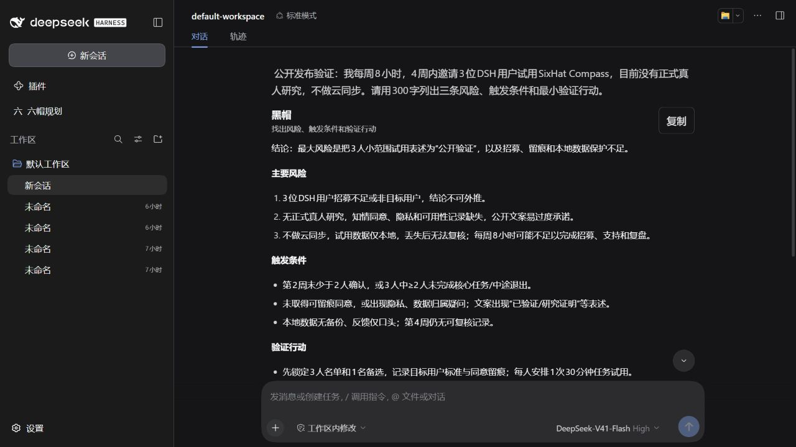

# SixHat Compass · 六帽规划

在 **DeepSeek Harness（DSH）原生聊天**中切换六种思考视角，评审计划、探索替代方案、明确下一步。

**0.1.0-preview.5 · 社区插件 · MIT**

```text
@黑帽 我每周8小时，计划4周内找3位用户试用。先指出最需要验证的风险。
@绿帽 基于上面的计划，给两种成本更低的验证方案。
@白帽 区分已知信息、假设和信息缺口。
```

帽子名后加空格。输入 `@` 可选择帽子，选中只补全，发送才调用。请求保存并受理后输入框清空，模型在当前消息流继续回复；可以先写下一条草稿。失败、停止或中断的已受理任务可从记录页恢复，不会自动重发。



## 六种视角

| 调用 | 用途 |
|---|---|
| `@白帽` | 区分事实、假设与信息缺口 |
| `@红帽` | 表达直觉与可能的情绪反应 |
| `@黑帽` | 找出风险、触发条件和验证行动 |
| `@黄帽` | 分析价值与收益成立条件 |
| `@绿帽` | 提出实质不同的替代方案 |
| `@蓝帽` | 整理目标、分歧与下一步 |

单帽通常一次模型调用，直接返回自然语言建议，不自动启动其他角色或生成卡片。每条回复可复制，来源与用量折叠展示。

单独发送 **`@新讨论`** 创建独立讨论，不调用模型。高级入口 **`@评审`** 生成结构化决策卡，**`@六帽`** 执行完整评审，通常分别1次、6次调用。记录页支持查找、恢复、卡片编辑和 Markdown 导出。

## 安装

要求 **Node.js ≥24**，支持 **DSH 0.2.0-rc.2、0.2.1-rc.2 或 0.2.1-rc.3**；Windows 下实测 CLI/Web 0.2.0-rc.2、0.2.1-rc.2，以及 Desktop 0.2.1-rc.2 / rc.3，模型 deepseek-flash。在 [Releases](https://github.com/NaFkevin/sixhat-compass/releases) 下载对应 `.tgz` 并核对随附的 `SHA256SUMS.txt`。

桌面端：打开“插件 → 添加插件”，输入下载的 `.tgz` 完整路径；不要选择版本兼容豁免。Preview.3 不支持 0.2.1；Preview.4 不支持 0.2.1-rc.3。rc.3 用户请使用 Preview.5。

CLI/Web：关闭目标 DSH，确认与启动时相同的 `DSH_HOME` / `web` profile：

```powershell
dsh plugin --profile web add 'C:\下载目录\dsh-sixhat-compass-0.1.0-preview.5.tgz'
dsh web --no-open --host 127.0.0.1 --port 3088
```

模型和密钥在 DSH 中配置，插件继承**全局默认模型**，可能与聊天框临时模型不同。设置位于 **DSH 设置 → 六帽规划**；侧栏“六帽规划”打开评审记录。默认全部六帽启用、标准回复、用量折叠，重启保留。

旧 HexaMind 或 Liumao Planner 用户先备份，再按[升级步骤](docs/preview/install.md)替换包，避免同时加载两个插件。旧配置、API、命令和存储的内部 `hexamind` 标识保留兼容；本项目与同名 AI 服务公司无关联。

## 开发与验证

```powershell
npm ci --ignore-scripts --no-audit --no-fund
npm run typecheck
npm run build
npm test
npm pack --pack-destination artifacts
```

客户端复用宿主 React 与公开扩展接口，不引入大型 UI 框架，不改写宿主页面结构。模型工具列表为空，不执行命令、读文件或联网核验。只有消息开头的已知帽子命令进入插件，正文、引用与代码中的 `@` 不触发帽子。

上下文仅当前会话最近的普通文本与帽子回复：最多20条、合计24000字符，按完整消息选取，本次问题不截断；来源与遗漏数可展开查看。

## Preview 边界

已有开发者非结构化试用反馈，本次修复来自真实试用；**尚无按协议完成的真人产品价值验证或真人对照结论**，不能据此宣称六帽优于普通 AI。帽子使用同一模型，不是六位独立专家。来源关联不等于事实核验。

停止保留已接收内容，崩溃恢复到最后成功落盘检查点；不承诺取消后零费用。附件不支持，原生 Desktop、其他系统和全部中文输入法尚未完成验证。宿主纯命令会话可能被视为空白，请用 `@新讨论`；卸载后纯命令视图可能隐藏，日志与插件记录仍保留，重装恢复。

[安装与升级](docs/preview/install.md) · [已知限制](docs/preview/known-limitations.md) · [发布说明](docs/preview/release-notes.md) · [本轮验证报告](docs/reports/compass-preview-report.md) · [贡献指南](CONTRIBUTING.md) · [发布准备](docs/RELEASING.md)
