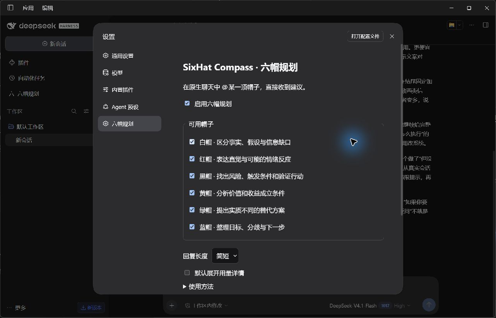

# Preview.4：DSH Desktop 0.2.1-rc.2 兼容修复

2026-10-24，Windows。Preview.3 的 peerDependencies 精确限定 0.2.0-rc.2，因此被桌面端 0.2.1-rc.2 正确拒绝；原包没有声明支持新版本。没有使用兼容性豁免，也没有修改用户现用 profile。

## 修复

- 兼容范围仅列出 `0.2.0-rc.2 || 0.2.1-rc.2`，不使用覆盖未知版本的宽范围。开发依赖仍锁定旧接口；另在官方 0.2.1-rc.2 依赖目录完成服务端类型检查。
- 官方 Desktop `forwardWebRequest` 拒绝非 `dsh-app://app` 来源，再移除 Origin、Sec-Fetch-Site，并注入宿主认证 Cookie。旧插件只接受浏览器同源来源头，会拒绝桌面转发请求。
- UI 请求增加 `x-sixhat-client: 1`。只有本机连接、本机 Host 且没有来源头与 Fetch-Site 的请求可以使用此分支；错误来源、跨站和预检仍被拒绝，不增加 CORS。
- 备份与决策卡导出先用带客户端头的 fetch 获取成功响应，再触发本地文件保存；错误 JSON 不会作为备份下载。
- 内部配置 ID、API、命令、存储目录及信封4保持不变。旧发行版、安装包和历史评测保留。

参考官方源码：[web-document.ts](https://github.com/deepseek-ai/deepseek-harness/blob/dsh-v0.2.1-rc.2/apps/desktop/src/web-document.ts)。

## 实际验证

1. 官方 npm CLI 0.2.1-rc.2 在隔离 web profile 安装 Preview.4 成功，打开原生聊天，黑帽完成一次真实调用，受理后输入框在生成时为空。
2. 已安装 Desktop 0.2.1-rc.2 使用独立 DSH_HOME 与 Electron user-data-dir；官方桌面自带安装器 pnpm 11.28.5 安装成功。测试窗口地址为 `dsh-app://app/`。
3. Desktop 黑帽与绿帽连续真实调用均完成，每条只有1次调用，无自动卡片；上下文分别0条、2条，模型均为全局默认 deepseek-official/deepseek-flash。
4. Desktop 设置显示品牌和六帽选项，回复长度由标准改为简短，宿主 patch 已保存。设置页点击备份，系统保存对话框下载的 JSON 可解析，含2条真实测试记录。
5. 使用官方 Desktop 转发函数连接真实 Web 宿主：状态200、备份200、外部来源403。真实原生调用记录与哈希见 [desktop-021.json](desktop-021.json)。
6. 类型检查、构建与65项自动测试通过；新增请求来源与下载回归测试。干净检出和跨平台 CI 以本次发布记录为准。



## 复现

```powershell
npm ci --ignore-scripts --no-audit --no-fund
npm run typecheck
npm run build
npm test
npm pack --pack-destination artifacts
```

在官方 Desktop 0.2.1-rc.2 的“插件 → 添加插件”选择 Preview.4 tgz。发送 `@黑帽 评审这个首版的主要风险`，再发 `@绿帽 给两个低成本验证方法`。核对每条调用数1、上下文0/2、无决策卡。设置修改回复长度，关闭重开设置核对；点击备份并检查 JSON。

测试时桌面安装器首次遇到 `database disk image is malformed`，使用独立 pnpm store 后安装成功，没有清理现有缓存。该缓存错误与插件版本拒绝是不同问题。截图中另一个社区插件的版本提示也未通过改动本插件处理。

## 边界

此轮验证只覆盖上述版本、Windows 和该供应商。尚未重新完整执行旧阶段的所有崩溃、卸载、附件和全部中文输入法场景；旧阶段记录不能冒充本轮实测。未验证用户现用的全部社区插件组合，正式真人产品价值验证仍未完成。
