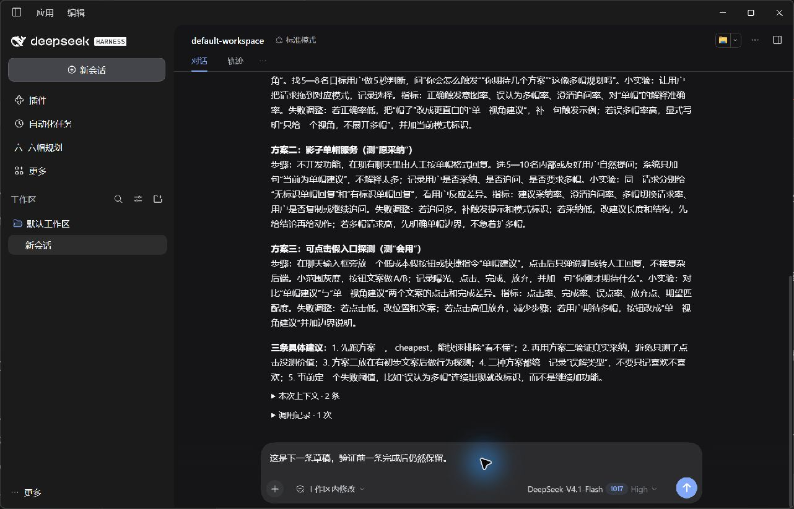

# Preview.5：DSH Desktop 0.2.1-rc.3 兼容修复

2026-10-25，Windows。Preview.4 精确限定两个宿主版本，实际桌面端升级到 rc.3 后被兼容检查停用。通过 rc.3 官方 `evaluatePluginCompatibility` 对 Preview.4 的原清单复现拒绝，再修正声明，未使用版本豁免。

## 实现与接口核对

Preview.5 仅新增已核对的 `0.2.1-rc.3`，保留 `0.2.0-rc.2` 和 `0.2.1-rc.2`。产品运行逻辑没有变化，仅状态端点报告的新插件版本改变；内部 ID、命令、API、存储位置和信封4不变。

[官方 rc.3 发布说明](https://github.com/deepseek-ai/deepseek-harness/releases/tag/dsh-v0.2.1-rc.3) 与 rc.2 对比已核对。草稿初始化增加可选策略、会话导航修改空白复用行为；本插件仍使用公开命令、输入触发器和独立会话创建接口。官方 Desktop `web-document.ts` 在两个标签的 Git blob 均为 `a74ea7c7efd34bd916228bffa2bec782ef562c29`，原有转发适配保留。

新增 `scripts/check-host-compat.mjs`：从隔离官方宿主加载真实兼容检查器、不授予豁免，并用该宿主依赖编译服务端适配器。CI 在 Windows/Linux 上分别安装 rc.2 与 rc.3 执行检查。此检查覆盖声明和服务端接口，不能替代 CJS 客户端和真实桌面验证。

## 实际结果

- 官方 Desktop 0.2.1-rc.3 自带 pnpm 11.28.5 在独立 DSH_HOME / Electron user-data-dir 安装 Preview.5 成功，显示六帽入口。
- 在 `dsh-app://app/` 原生聊天连续发送黑帽、绿帽，均完成1次真实 deepseek-official/deepseek-flash 调用；上下文0条、2条，无自动卡片。
- 绿帽受理且仍在等待模型回复时，输入框已为空；期间输入下一条草稿，模型完成后草稿保持原文。
- 将此前隔离环境的2条 Preview.4 记录作为升级样本，新库里的旧对象逐字段一致。未读取或改写用户现用的私人记录。
- 状态端点200，备份端点200且含全部4条记录，外部 Origin 返回403。
- 官方 rc.2、rc.3 的兼容门禁和服务端类型检查通过；67项单元/回归测试通过。

机器记录见 [desktop-021rc3.json](desktop-021rc3.json)。CI 和最终包哈希见本次 Release。



## 复现

```powershell
npm ci --ignore-scripts --no-audit --no-fund
npm run typecheck
npm run build
npm test
npm pack --pack-destination artifacts
```

安装官方 rc.2 或 rc.3 到隔离工程后，可执行 `node scripts/check-host-compat.mjs <该工程目录>` 重跑该宿主的兼容和类型检查。CI 给出完整隔离安装命令。

在 Desktop 0.2.1-rc.3 中安装 Preview.5，发送 `@黑帽 评审这个首版的风险`，再发送 `@绿帽 详细比较低成本验证方案`；第二条等待回复时确认原输入框为空，写入未发送草稿，完成后确认仍保留。

## 未完成项

本轮是兼容性增量验证，没有重新完整运行历史的崩溃、卸载、全部输入法和附件场景。CI 通过不代表 Linux 原生桌面或所有社区插件组合实测通过。正式真人产品价值验证仍未完成。未知宿主版本继续被拒绝；后续宿主升级仍需验证，不能以放宽范围代替证据。
